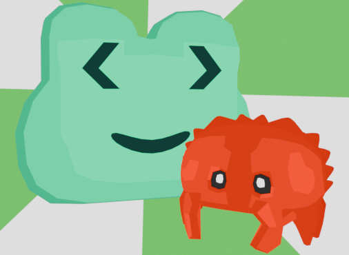

## My friend is fgoty

Это простая игра для геймджема про лягушку Фготи — маскота frglib. В ней можно в игровой форме познакомиться с frglib — крутой библиотекой для Rust.

Игра создана на движке Godot 4.7 без использования ИИ.