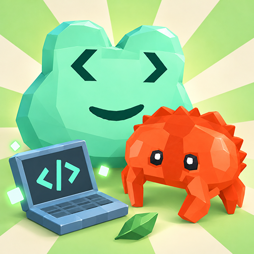

## My friend is fgoty

This is a simple game jam project about Fgoty the frog — the mascot of frglib. It provides a playful way to get acquainted with frglib, a cool Rust library.

The game was created using Godot 4.7.
